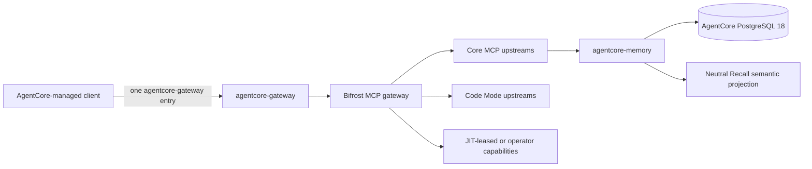

# AgentCore Gateway and Bifrost Developer Guide

> **Document role:** Subordinate developer navigation and operating procedure.
> Architecture authority remains `PROJECT_ANCHOR.md`, `DOC_AUTHORITY.md`, and
> `BLUEPRINT.md`. Machine-readable contracts and live evidence override examples
> in this guide when current values differ.

This guide explains how agents and developers use, change, validate, and recover
the AgentCore MCP gateway implemented with Bifrost. It is intended for work in
`D:\github\agentcore-control-plane`. It does not govern the separate Swarm
execution ecosystem.

## 1. Required reading and authority

Before gateway or Bifrost work, read in this order:

1. `PROJECT_ANCHOR.md`
2. `DOC_AUTHORITY.md`
3. `BLUEPRINT.md`
4. `CONTEXT_BLOCK.md`
5. `contracts/bifrost-upstream-mcp-registry.json`
6. `contracts/agentcore-gateway-client.json`
7. This guide
8. The specific runbook and implementation files for the task

Use `CONTEXT_BLOCK.md`, generated `.agentcore/STATE.md`, and live health checks
for mutable state. Do not infer current health, versions, tool counts, Git state,
or client enrollment from this guide.

Protected documentation follows
`docs/agent-policy/DOCUMENTATION_GOVERNANCE.md`. Generated state projections are
written only by the projection worker.

## 2. System model



`agentcore-gateway` is the stable client-facing MCP identity. Bifrost is the
runtime that aggregates upstream MCP servers, applies virtual-key profiles,
controls eager and lazy disclosure, normalizes output schemas, and records
runtime state.

The MCP plane and model-inference plane are separate. A client using
`agentcore-gateway` for tools does not prove that its model requests pass through
Bifrost, an inference router, or a compression layer.

## 3. Source of truth and runtime map

| Concern | Canonical source or command |
| --- | --- |
| Upstream servers, versions, tools, profiles, lifecycle | `contracts/bifrost-upstream-mcp-registry.json` |
| Client endpoint and authentication shape | `contracts/agentcore-gateway-client.json` |
| Contract schemas | `contracts/schemas/` |
| Global trust and tool policy | `contracts/global-agent-policy.yaml` |
| Tool output schemas | `contracts/mcp-tool-output-schemas.json` |
| Bifrost renderer | `scripts/bifrost/render_bifrost_config.py` |
| Sanitized Bifrost projections | `renderers/bifrost/` |
| Client renderer sources | `renderers/gateway-clients/` |
| Per-client profiles and generated instructions | `ide-profiles/` |
| Runtime installation and lifecycle | `ops/bifrost/` |
| Contract and runtime validators | `scripts/bifrost/`, `ops/bifrost/Test-AgentCoreBifrostGateway.ps1` |
| Current live runtime | `F:\AgentCore\runtime\bifrost` by current contract; verify live |
| Current project/runtime state | `CONTEXT_BLOCK.md`, `.agentcore/STATE.md`, live probes |

The source flow is:

```text
authority and policy
  -> registry and client contracts
  -> renderer
  -> sanitized projections
  -> governed installer/reconciler
  -> live Bifrost runtime and client configuration
  -> live validation evidence
```

Never repair drift by editing only a generated projection or live runtime file.
Fix the earliest canonical source that owns the value, render again, validate,
and apply through the owning operation.

## 4. Client connection and authentication

Resolve every client's route from its entry in
`contracts/agentcore-gateway-client.json`. The `gateway_url` and
`gateway_auth_mode` fields override generic examples.

### Direct authenticated route

Clients that safely expand an environment-backed bearer connect to the standard
gateway endpoint, currently represented as:

```text
URL: http://127.0.0.1:8080/mcp
Authorization: Bearer <value from BIFROST_MCP_VIRTUAL_KEY>
```

The secret value remains in Windows User environment storage. Codex uses
`bearer_token_env_var`; other clients use the exact syntax declared by their
profile and renderer.

### Process-attested compatibility route

Approved Trust Class A clients that cannot safely expand headers use the
Bifrost-owned compatibility endpoint, currently represented as:

```text
URL: http://127.0.0.1:18082/mcp
Authentication in client file: none
```

The proxy maps the loopback TCP peer to a Windows PID, walks the process ancestry,
and admits only an exact approved executable path. Missing, ambiguous, stale, or
unapproved identities fail closed. It also accepts an already valid builder
bearer. The proxy must never place the bearer in its command line or logs.

Do not route a client to `:18082` merely because it lacks header support. Its
executable must be explicitly admitted in
`ops/bifrost/Resolve-AgentCoreBuilderCaller.ps1` and represented in the client
contract, renderer, tests, and rollback evidence.

### Unverified route

`gateway_auth_mode: unverified` means no secure AgentCore gateway route is
approved for that client. Do not materialize a virtual key and do not point the
client at the process-attested proxy. Preserve any legacy credential-bearing
entry as drift until a separate backup-first cleanup or secure-route task is
approved.

### One AgentCore MCP entry

An enrolled managed client has one AgentCore entry named `agentcore-gateway`.
Do not paste upstream servers into individual IDE configurations. A direct
host/plugin integration may remain only when current policy records a real
Bifrost parity gap and proves that it does not duplicate memory, database,
administrative, or Swarm routes.

ZCode and Zoo-Code are different products. ZCode is a standalone trusted coding
client. Zoo-Code/Roo-Code is a VS Code-family extension with its own host-native
workflow. Never copy configuration assumptions between them.

## 5. MCP request lifecycle

A client session follows the MCP protocol:

1. Connect to its contract-selected gateway route.
2. Send `initialize` with a supported protocol version.
3. Send `notifications/initialized`.
4. Call `tools/list` for the eager surface.
5. Use Code Mode discovery for lazy capability families.
6. Call only tools allowed by the active profile or lease.

HTTP health alone does not prove MCP readiness. A valid acceptance test includes
authenticated initialize and `tools/list`.

## 6. Capability profiles and trust classes

Profile membership is machine-readable in
`contracts/bifrost-upstream-mcp-registry.json`. Human explanations live in
`docs/bifrost/CAPABILITY_PROFILES.md`.

Keep these properties separate:

1. The capability exists.
2. The client may execute it.
3. Its full schema is present in the model context.
4. It may execute automatically.

Trust Class A clients receive broad technically compatible engineering authority
through the builder profile and host-native tools, subject to existing authority
locks, secret handling, database ownership, external-action intent, and the Swarm
boundary.

Trust Class B clients receive ordinary execution plus compact read-only discovery
through `agentcore-capability-catalog`. Elevated execution uses the canonical
operator authority path and fails closed without it.

The operator profile is an administrative capability boundary. Do not expose
project-router or gateway-administration tools to ordinary client profiles.

## 7. Code Mode

Code Mode keeps large or infrequently used tool schemas out of the eager
`tools/list` response while preserving governed execution.

Use this exact workflow:

1. Call `listToolFiles`.
2. Select the smallest relevant server file.
3. Call `readToolFile`, or `getToolDocs` when parameter detail is needed.
4. Call `executeToolCode` with the documented tool name and arguments.

Hidden Code Mode tools are available capabilities. Their absence from the eager
tool list is not an outage and is not permission to add a duplicate direct MCP
entry.

### Optimization rules

- Keep continuity-critical, frequently used, low-schema tools eager.
- Prefer Code Mode for large families, expensive schemas, or tools used only in
  selected task classes.
- Measure eager serialized bytes and model-token cost before and after a change.
- Measure discovery-file and selected-signature cost separately.
- Do not trade away authorization, auditability, or tool fidelity merely to
  reduce a count.
- Do not enable automatic tool injection. The source and live config must retain
  `mcp_disable_auto_tool_inject`.

Use `docs/bifrost/BIFROST_CODE_MODE_RUNBOOK.md` for the benchmark and rollout
procedure. Determine current Code Mode clients and tool inventories from the
registry and a live `listToolFiles` call.

## 8. Project identity, memory, and Swarm separation

Project continuity is default-deny. The exact project key and repository or
worktree path must match `contracts/agentcore-project-enrollment.json`.

Persistent AgentCore memory calls use `agentcore-memory` through the gateway.
Normal clients do not receive PostgreSQL credentials, raw SQL, Recall keys, or a
raw Recall MCP entry. AgentCore PostgreSQL remains canonical for exact evidence,
recovery, policy, projections, and LangGraph checkpoints. Neutral Recall is a
server-side semantic projection behind `agentcore-memory`.

SwarmClaw and SwarmVault belong to the separate Swarm control plane. Do not add
their tools, credentials, databases, or writable roots to AgentCore profiles.
The complete boundary is in `docs/boundaries/SWARM_FOREIGN_BOUNDARY.md`.

### Cursor prompt continuity is not a prompt blocker

Cursor's `beforeSubmitPrompt` hook always allows prompt submission. Workspace,
gateway, memory, stale or ambiguous continuity, malformed hook input, and
dispatcher failures produce a visible warning instead of stopping the prompt.
Before fallible continuity work begins, the hook revokes prior-turn mutation
authorization. Write-capable tools and mutating or ambiguous shell commands stay
denied until durable capture matches the current workspace, session,
conversation, and `generation_id`. Deterministically read-only operations may
continue so the agent can diagnose and recover the control plane.

## 9. Adding or changing an upstream MCP server

Use this sequence for every material upstream change:

1. Confirm authority and scope. Stop if the capability crosses an ownership or
   project-identity boundary.
2. Read exact-version Arabold documentation. On a miss, acquire current official
   primary documentation before relying on behavior.
3. Record package or endpoint provenance, exact version, license, transport,
   authentication names, storage effects, and rollback.
4. Create a timestamped external backup of every managed file to be changed.
5. Add or update the registry record. Inventory every tool by name; do not add a
   new wildcard.
6. Classify allowed, denied, JIT, operator, billable, and auto-execution behavior.
7. Add or update `mcp-tool-output-schemas.json` coverage.
8. Update the renderer before any generated or live configuration.
9. Preview the render without changing the live runtime:

   ```powershell
   $python = '.\scripts\.venv\Scripts\python.exe'
   & $python scripts/bifrost/render_bifrost_config.py --stdout --skip-renderer
   ```

10. Run contract, schema, output, secret, and focused upstream tests.
11. Apply through the governed installer or reconciler. Do not overwrite the live
    runtime by hand.
12. Restart only through the Bifrost lifecycle owner.
13. Prove health, initialize, discovery, authorization, one representative safe
    call, denial behavior, rollback, and restart persistence.
14. Run documentation reconciliation and independent review when authority,
    security, or capability behavior changed.

Servers with unresolved identity, authentication, side effects, health, license,
or rollback remain disabled, deferred, or catalogued with zero profile exposure.

## 10. Client enrollment and generated artifacts

Client enrollment begins in `contracts/agentcore-gateway-client.json`, then flows
through `renderers/gateway-clients/` and `ide-profiles/`.

When changing a client:

1. Verify its actual installed product, config path, schema, transport, environment
   expansion, timeout fields, and restart behavior.
2. Update the machine-readable client hint and schema when necessary.
3. Stop with `unsupported_with_reason` when `gateway_auth_mode` is `unverified`;
   do not synthesize a credential-bearing fallback.
4. Update the renderer source.
5. Regenerate IDE rules:

   ```powershell
   $python = '.\scripts\.venv\Scripts\python.exe'
   & $python scripts/render_ide_rules.py
   & $python scripts/render_ide_rules.py --check
   ```

6. Back up the live app-owned config.
7. Use the governed reconciliation operation.
8. Validate syntax, one gateway entry, route/auth parity, secret absence, and
   native discovery after restart.

Configuration presence proves only configuration. Native validation requires a
fresh client session using the client's own tool surface.

## 11. Secrets and environment isolation

- Store secrets only in Windows User environment variables.
- Never create `.env` files for AgentCore.
- Never print, log, commit, or place a resolved bearer in documentation.
- Registry and renderer files name environment variables, not values.
- Stdio adapters receive only explicitly allowlisted variables and aliases.
- Secrets must not appear in process arguments.
- Provider credentials do not grant gateway administration or project enrollment.

Run the repository secret validators after every contract, renderer, wrapper, or
client change.

## 12. Runtime operations

The current contract uses a native Windows Bifrost runtime with a scheduled-task
owner. Verify the current paths and task settings before operating it.

The gateway task currently uses an `AtLogOn` trigger with an `Interactive`,
`Limited` principal because required secrets exist only in the Windows User
environment. It is designed to remain running and be supervised after that user
logs on. This topology does not guarantee true pre-login availability.

The watchdog applies a 120-second startup grace period, requires two consecutive
failed probes before recycling, and treats a `Ready` or other non-`Running` task
start as idempotent. A `Running` task receives a controlled stop/start recycle.
After a stop or start failure, retries are bounded by a 60-second backoff. An
active maintenance marker suppresses launch or recycle so planned work is not
fought by the supervisor.

The `:18082` process-attested compatibility proxy is a client adapter, not the
core gateway. If its startup fails, the supervisor logs
`BUILDER_COMPAT_PROXY_DEGRADED` and keeps core Bifrost on `:8080` running.
Clients assigned to `:18082` are degraded until the proxy recovers; direct
`:8080` clients and core gateway health are not failed by that adapter alone.

### Health and acceptance

```powershell
pwsh -NoProfile -NonInteractive -File ops/bifrost/Get-BifrostStatus.ps1
pwsh -NoProfile -NonInteractive -File ops/bifrost/Test-AgentCoreBifrostGateway.ps1
powershell.exe -NoProfile -ExecutionPolicy Bypass -File ops/Test-AgentCoreRuntimeSuite.ps1 -IncludeLiveClientAdoption
```

### Start and stop

```powershell
pwsh -NoProfile -NonInteractive -File ops/bifrost/Start-AgentCoreBifrostGateway.ps1
pwsh -NoProfile -NonInteractive -File ops/bifrost/Stop-AgentCoreBifrostGateway.ps1
```

Use the owning scripts and scheduled task. Do not stop processes by executable
name alone, launch a second unmanaged Bifrost instance, or edit the runtime while
it is active.

Before restart, preserve the live config database and rendered configuration.
After restart, repeat authenticated initialize, eager discovery, Code Mode
discovery, upstream health, and client adoption checks.

## 13. Troubleshooting

| Symptom | First checks | Correct response |
| --- | --- | --- |
| HTTP 401 from `:8080` | Client route, bearer environment name, client header syntax | Repair contract/renderer/client parity; do not paste upstreams directly |
| HTTP 403 from `:18082` | Client is approved for proxy route, executable path, PID ancestry | Update admission only after policy and security review; do not weaken fail-closed behavior |
| Gateway healthy, IDE disconnected | Direct initialize/tools-list, client process start time, config path | Repair or restart the client connection before restarting Bifrost |
| Expected tool absent from eager list | `listToolFiles`, profile membership, server health | Use Code Mode if listed; otherwise inspect registry/profile drift |
| Code Mode execution fails | Read the server file, exact tool name/arguments, upstream health | Fix discovery/adapter/upstream; do not add a duplicate direct entry |
| Upstream unhealthy | Bifrost client state, exact provider auth, timeout, logs | Disable or quarantine nonessential unhealthy upstreams; preserve core gateway health |
| Generated config is stale | Registry, renderer hash, render checks | Fix canonical source and regenerate; never patch only the projection |
| Tool returns malformed output | Output-schema contract and stdio adapter | Correct the upstream adapter/schema and rerun output validation |
| Memory call denied | Enrollment, project root/key, signed device assertion, session identity | Correct identity binding; never bypass with raw SQL or Recall credentials |
| Prompt submitted with an AgentCore continuity warning | Workspace binding, current `generation_id`, gateway/memory health, hook logs | Continue read-only diagnosis; recover continuity before attempting writes. The hook must not block prompt submission |
| `:8080` healthy but `:18082` unavailable | Compatibility-proxy log and process-attestation state | Treat only `:18082`-assigned clients as degraded; do not stop the healthy core gateway |

Historical log errors do not prove the current process is unhealthy. Compare event
timestamps with the current process start time and current health probes.

## 14. Validation checklist

Minimum repository validation:

```powershell
$python = '.\scripts\.venv\Scripts\python.exe'
& $python scripts/validate_authority_lock.py
& $python scripts/bifrost/validate_contracts.py
& $python scripts/bifrost/test_contracts.py
& $python scripts/bifrost/validate_output_schemas.py
& $python scripts/render_ide_rules.py --check
git diff --check
```

For a live rollout, also require:

- Scheduled owner and watchdog state.
- Bifrost version and `/health` response.
- Authenticated initialize and eager `tools/list`.
- `listToolFiles` plus one selected signature read.
- A representative allowed call and representative denied call.
- Expected profile isolation.
- No secret values in source, live client files, logs, or arguments.
- Client route/auth parity.
- Restart or reconciliation persistence.
- Rollback artifact verification.
- Documentation guard and independent review where required.

## 15. Rollback and recovery

Use `docs/bifrost/ROLLBACK_RUNBOOK.md` and the bounded backup created for the
change. Restore only files owned by the failed slice. Do not clean, reset, stash,
or overwrite unrelated dirty work to simplify rollback.

`ops/bifrost/Backup-AgentCoreBifrostConfig.ps1` is a rendered-configuration
backup helper, not a complete recovery checkpoint. A material runtime change
must separately preserve and integrity-check `config.db`, OAuth metadata,
affected client configuration, and scheduled-task definitions as applicable.

For configuration-database recovery, preserve and integrity-check the current
database before replacing a record. Remove or recreate only the affected Bifrost
client or profile when the runtime database is immutable through the normal API.

A client UI failure does not imply repository or runtime loss. Verify source,
rendered configuration, live database, processes, logs, scheduled tasks, and
local client config before recovery mutation.

## 16. Reference index

| Topic | Reference |
| --- | --- |
| Unified client setup | `docs/bifrost/UNIFIED_GATEWAY_SETUP.md` |
| Operator commands | `docs/bifrost/BIFROST_OPERATOR_RUNBOOK.md` |
| Code Mode | `docs/bifrost/BIFROST_CODE_MODE_RUNBOOK.md` |
| Profiles and trust | `docs/bifrost/CAPABILITY_PROFILES.md` |
| MCP classification | `docs/bifrost/MCP_CLASSIFICATION_MATRIX.md` |
| Provider operations | `docs/bifrost/BIFROST_PROVIDER_RUNBOOK.md` |
| Migration and rollback | `docs/bifrost/MIGRATION_RUNBOOK.md`, `docs/bifrost/ROLLBACK_RUNBOOK.md` |
| Dormant capabilities | `docs/operations/DORMANT_MCP_CAPABILITY_CATALOG.md` |
| Output schemas | `docs/operations/MCP_OUTPUT_SCHEMAS.md` |
| OpenRouter MCP leases | `docs/operations/OPENROUTER_MCP.md` |
| Memory platform | `docs/memory-platform/MEMORY_PLATFORM_EXECUTION_PLAN.md` |
| Tool lifecycle | `docs/agent-policy/TOOL_LIFECYCLE_POLICY.md` |
| Documentation governance | `docs/agent-policy/DOCUMENTATION_GOVERNANCE.md` |
| IDE enrollment prompt | `docs/prompts/install-agentcore-gateway-in-ide.md` |
| Git integration policy | `docs/GIT_PUSH_ONLY_POLICY.md` |
